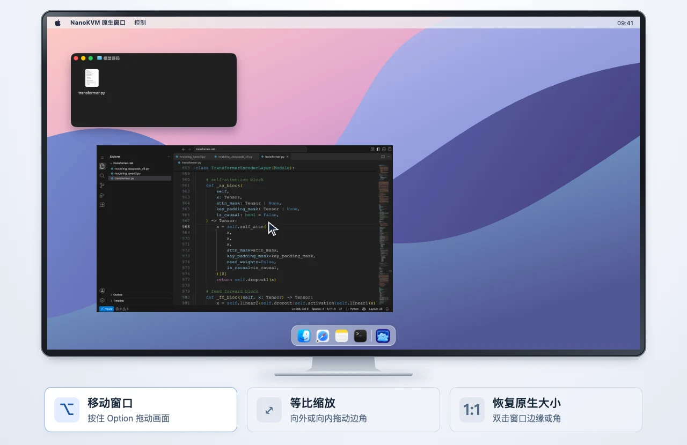

#  NanoKVM PixelWindow

坐在 Mac 前，用同一套键盘、鼠标和显示器操作旁边的 Windows 电脑。**Sipeed NanoKVM-USB** 采集被控机的 HDMI 画面，并通过 USB 把键鼠输入送回去。**PixelWindow** 在 Mac 本地运行，把这路画面放进一扇能移动、能缩放的无边框窗口。

**[下载 macOS 版（DMG）][dmg]** · [版本说明](https://github.com/LiuJH12138/NanoKVM-PixelWindow/releases/latest) · macOS 14+ · Intel 和 Apple 芯片

## 在 Mac 显示器上移动和缩放窗口



按住 **Option** 拖动画面，可以把被控端挪到 Finder 旁边。想看清小字时，拖动窗口边缘或角即可等比缩放。双击边缘或角，窗口就会回到原生像素大小。

## 本地控制与现场运维

- **替代网络远控。** 两台电脑用线接好，只需在 Mac 安装应用。即使被控机没有联网，或防火墙限制了远程桌面连接，也可以在 Mac 上查看画面、操作键鼠。
- **让数据留在本地。** 屏幕画面和键鼠输入沿 HDMI、USB 在设备之间传递，无需云端账号或中转服务器。传文件时由你选择中转 U 盘，无需为此开放网络共享端口。
- **在现场排查故障。** 例如修改网络配置后远程桌面断开，只要机器仍有 HDMI 输出并能接收 USB 键鼠，就可以从 Mac 打开被控机的网络设置，检查 IP 地址或恢复配置。

## 从 Mac 传文件到被控端


把源码从 Finder 拖入采集窗口。看到「U 盘已安全推出」后，将 NanoKVM 拨到 **T**，就能在 Windows 上打开文件。

主编辑区展示 [PyTorch Transformer 的自注意力实现](https://github.com/pytorch/pytorch/blob/6c3ba919b09a804c59ea37bcc826150c054840e0/torch/nn/modules/transformer.py#L960-L977)，旁边两个标签页分别打开了 [DeepSeek-V3](https://github.com/huggingface/transformers/blob/3d2d3b3f7bed13f858da128cd932a2f8d36e1490/src/transformers/models/deepseek_v3/modeling_deepseek_v3.py) 和 [Qwen3](https://github.com/huggingface/transformers/blob/3d2d3b3f7bed13f858da128cd932a2f8d36e1490/src/transformers/models/qwen3/modeling_qwen3.py) 的模型源码。

## 为什么做这个窗口

我用一台 Mac 和一块 **Sipeed NanoKVM-USB 标准版**操作 Windows 笔记本。Windows 输出 1080p，而 Mac 接的是 4K 显示器。把采集画面铺满屏幕时，文字也被放大了。我想在 Mac 桌面上留一块区域给 Windows，看清小字，旁边还能放自己的应用，于是做了这个 Swift 原生窗口。

窗口里只有被控电脑的画面。默认情况下，一个采集像素对应一个窗口缓冲区像素。在我的 4K 显示器使用 2× 显示缩放时，窗口占 **960 × 540 个 macOS 坐标点**，实际显示 **1920 × 1080 个像素**。也可以拖大窗口看细节，再双击边沿回到原始大小。

## 下载安装

[下载通用安装包][dmg]，双击打开，将「NanoKVM 原生窗口」拖入「Applications（应用程序）」文件夹。

此版本采用本地临时签名，尚未经过 Apple 公证。如果首次打开时 macOS 提示无法验证开发者，请确认下载来源并按[苹果的说明](https://support.apple.com/zh-cn/102445)操作。

## 使用的硬件

这是我为 Sipeed NanoKVM-USB 编写的第三方 macOS 客户端。NanoKVM-USB 硬件和官方软件由 Sipeed 提供。应用通过 AVFoundation 读取 USB 视频，通过 USB 串口把 Mac 的键鼠操作发送到被控电脑。[Sipeed 产品介绍](https://wiki.sipeed.com/hardware/zh/kvm/NanoKVM_USB/introduction.html) · [Sipeed 官方代码仓库](https://github.com/sipeed/NanoKVM-USB)

| 连接 | 用途 |
| --- | --- |
| 主控 Mac → NanoKVM 的 Host USB-C | Mac 接收视频并发送键鼠操作 |
| Windows 笔记本的 HDMI 输出 → NanoKVM 的 HDMI IN | 采集 Windows 桌面 |
| Windows 笔记本的 USB → NanoKVM 的 Target USB-C | Windows 接收键鼠输入 |

显示器可以继续接在 Mac 上。需要用另一块显示器直接看同一路 Windows 画面时，再接 NanoKVM 的 HDMI 环出。[官方接线与上手教程](https://wiki.sipeed.com/hardware/zh/kvm/NanoKVM_USB/quick_start.html)

## 在 Mac 上构建和运行

工程使用 Swift、AppKit、AVFoundation 和 IOKit。部署目标为 macOS 14 或更新版本，编译需要包含 macOS 15 或更新 SDK 的 Xcode 工具链。脚本会为当前 Mac 的处理器架构编译并在本地签名。

```sh
git clone https://github.com/LiuJH12138/NanoKVM-PixelWindow.git
cd NanoKVM-PixelWindow
./build.sh "$PWD/.build/NanoKVM 原生窗口.app"
open "$PWD/.build/NanoKVM 原生窗口.app"
```

首次打开时允许摄像头权限，macOS 会把 HDMI 采集卡识别为 USB 摄像头。再从系统菜单栏的 **控制** 菜单选择 NanoKVM 对应的串口。应用会记住选择。如果之前用过官方浏览器版，请先关闭占用串口的控制页。

## 操作

| 操作 | 效果 |
| --- | --- |
| 在画面内点击、打字或滚动 | 操作被控电脑，画面内的双击也会传给 Windows |
| 按住 Option 拖动画面 | 在 Mac 桌面上移动窗口 |
| 拖动任意边缘或角 | 按视频宽高比缩放 |
| 双击边缘或角 | 恢复原生像素大小，桌面空间不足时等比缩小 |
| Command + W 或 Command + Q | 关闭窗口或退出应用 |

## 用 U 盘从 Mac 传文件到 Windows（1.2）

1. 把两端均可读写的 U 盘（例如 exFAT）接到 NanoKVM 的 USB-A 口，拨到 **H**，等它出现在 Finder。
2. 从 Finder 把文件或文件夹拖到视频窗口。首次传输时按卷名选定中转盘；以后通过「控制 → 选择中转 U 盘」可以换盘。每批文件放在 U 盘根目录下独立的 `NanoKVM-日期_时间-编号` 文件夹中。
3. 等窗口显示「U 盘已安全推出」后拨到 **T**，在 Windows 中打开这批文件。下一批传输前，先在 Windows 安全弹出 U 盘，再拨回 **H**。

复制遇到错误时窗口会提示。已复制但推出失败时，请关闭占用 U 盘的程序，并在 Finder 中手动推出后再切换。

## 兼容范围与画质

我用 Intel Mac、4K 显示器、Windows 笔记本和 NanoKVM-USB 标准版验证了 1080p 采集、边角缩放和双击复原。当前识别的视频设备为 `USB3 Video`（USB ID `345f:2131`），串口为 CH340（`1a86:7523`）。其他硬件版本可能使用不同的标识。

如果小字发糊，先在 Windows 的 **设置 → 系统 → 屏幕 → 高级显示** 中选择 NanoKVM 对应的外接屏。我这台电脑原来用 1920 × 1200 的桌面输出 1920 × 1080 的 HDMI 信号。把「桌面模式」和「活动信号模式」都调成 **1920 × 1080、60 Hz** 后，文字明显更清楚。这里的 60 Hz 指 Windows 输出的刷新率，实际采集帧率还取决于 USB 连接和主控设备。[Sipeed 画质排查说明](https://wiki.sipeed.com/hardware/zh/kvm/NanoKVM_USB/faq.html)

习惯用 Chrome 的用户也可以使用 Sipeed 提供的浏览器版。[官方本地部署教程](https://wiki.sipeed.com/hardware/zh/kvm/NanoKVM_USB/deployment.html)

作者：[LiuJH12138](https://github.com/LiuJH12138)

[dmg]: https://github.com/LiuJH12138/NanoKVM-PixelWindow/releases/download/v1.2.1/NanoKVM-PixelWindow-1.2.1-macOS-universal.dmg
