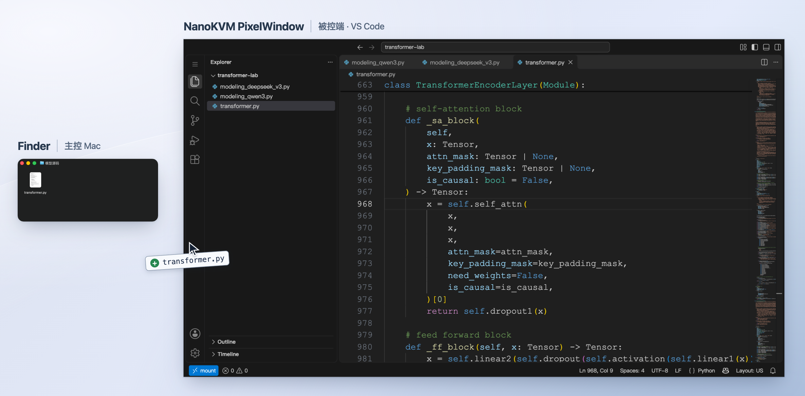

<h1 align="center"> NanoKVM PixelWindow</h1>

<p align="center"><strong>用 Mac 的键鼠操作旁边的 Windows，把它的桌面放进一扇无边框窗口。</strong></p>

<p align="center"><a href="https://github.com/LiuJH12138/NanoKVM-PixelWindow/releases/latest">v1.2.1</a> &nbsp;·&nbsp; macOS 14+ &nbsp;·&nbsp; Intel 和 Apple 芯片</p>

<p align="center"><strong><a href="https://github.com/LiuJH12138/NanoKVM-PixelWindow/releases/download/v1.2.1/NanoKVM-PixelWindow-1.2.1-macOS-universal.dmg">下载 macOS 安装包</a></strong> · <a href="#快速上手">快速上手</a> · <a href="#从-mac-传文件到被控端">U 盘传文件</a> · <a href="#兼容范围与画质">画质排查</a></p>


**Sipeed NanoKVM-USB** 负责采集被控机的 HDMI 画面，并通过 USB 把键鼠输入送回去。**PixelWindow** 是运行在 Mac 本地的第三方客户端。按住 **Option** 拖动画面，就能把 Windows 挪到 Finder 旁边。拖动边角可以等比缩放。

## 本地控制与现场运维

| 什么时候用 | 这套连接能做什么 |
| --- | --- |
| 两台电脑共用一套桌面设备 | 显示器、键盘和鼠标继续接在 Mac 上。在采集窗口里操作 Windows，切回 Mac 应用就能继续手头的工作。 |
| 被控机离线，或防火墙限制远程桌面 | 只要被控机仍有 HDMI 输出并接受 USB 键鼠，就能在现场查看画面、检查 IP 地址或恢复网络配置。被控机无需安装远控客户端。 |
| 屏幕内容和文件需要留在本地 | 画面与键鼠输入通过线缆传递，无需云账号或中转服务器。传文件走自己选定的 U 盘，无需开放网络共享端口。 |

## 快速上手

**1. 接好三根线。** 以下是我使用 Sipeed NanoKVM-USB 标准版连接 Windows 笔记本的方式。

| 电脑端 | NanoKVM 端口 | 用途 |
| --- | --- | --- |
| 主控 Mac 的 USB | Host USB-C | 接收视频并发送键鼠操作 |
| 被控电脑的 HDMI 输出 | HDMI IN | 采集被控电脑画面 |
| 被控电脑的 USB | Target USB-C | 让被控电脑接收键鼠输入 |

Mac 的显示器继续接在 Mac 上。需要在另一块显示器直接看同一路被控画面时，再连接 NanoKVM 的 HDMI 环出。[Sipeed 官方接线教程](https://wiki.sipeed.com/hardware/zh/kvm/NanoKVM_USB/quick_start.html)

**2. 在 Mac 上安装。** [下载通用 DMG][dmg]，打开后将「NanoKVM 原生窗口」拖入「应用程序」。当前安装包采用本地临时签名，尚未经过 Apple 公证。如果 macOS 提示无法验证开发者，请先确认下载来源。[版本说明与校验值](https://github.com/LiuJH12138/NanoKVM-PixelWindow/releases/latest) · [Apple 首次打开说明](https://support.apple.com/zh-cn/102445)

**3. 打开画面并接通键鼠。** 首次启动时允许摄像头权限，macOS 会把 USB 采集卡识别为摄像头。看到被控桌面后，从 Mac 菜单栏的「控制」选中 NanoKVM 对应的串口，再在窗口内点击或打字。应用会记住这个选择。如果串口被官方浏览器版占用，先关闭对应的控制页。

## 在 Mac 显示器上移动和缩放窗口

| 想做什么 | 怎么操作 |
| --- | --- |
| 操作被控电脑 | 在画面内点击、打字或滚动，画面内的双击也会传给被控端 |
| 移动整个窗口 | 按住 **Option** 拖动画面 |
| 等比放大或缩小 | 拖动任意边缘或角 |
| 恢复原生像素大小 | 双击窗口边缘或角。桌面空间不足时会等比缩小 |
| 关闭窗口或退出应用 | **Command + W** 或 **Command + Q** |

## 从 Mac 传文件到被控端



1. 将两台电脑都能读写的 U 盘（例如 exFAT）接到 NanoKVM 的 USB-A 口，把拨键切到 **H**，等 U 盘出现在 Finder。
2. 从 Finder 把文件或文件夹拖入采集窗口。首次传输时按卷名选定中转盘，以后可通过「控制 → 选择中转 U 盘」更换。每一批文件都会放入 U 盘根目录下的独立文件夹。
3. 看到 **「U 盘已安全推出」** 后，把拨键切到 **T**，在 Windows 打开这批文件。下一批传输前，先在 Windows 安全弹出 U 盘，再拨回 **H**。

如果复制完成但推出失败，关闭占用 U 盘的程序，在 Finder 中手动推出后再切换。

图中展示的模型源码来自 [PyTorch Transformer 的自注意力实现](https://github.com/pytorch/pytorch/blob/6c3ba919b09a804c59ea37bcc826150c054840e0/torch/nn/modules/transformer.py#L960-L977)、[DeepSeek-V3](https://github.com/huggingface/transformers/blob/3d2d3b3f7bed13f858da128cd932a2f8d36e1490/src/transformers/models/deepseek_v3/modeling_deepseek_v3.py) 和 [Qwen3](https://github.com/huggingface/transformers/blob/3d2d3b3f7bed13f858da128cd932a2f8d36e1490/src/transformers/models/qwen3/modeling_qwen3.py)。

## 兼容范围与画质

**为什么做原生像素窗口？** 我的 Windows 笔记本输出 1080p，Mac 接的是 4K 显示器。把画面铺满屏幕，小字也跟着放大。我想在 Mac 桌面上留一块区域给 Windows，既能读代码，旁边也能放自己的应用。在我的 2× 显示缩放设置下，窗口占 **960 × 540 个 macOS 坐标点**，正好显示 **1920 × 1080 个采集像素**。

**文字发糊时先看哪里？** 在 Windows 的「设置 → 系统 → 屏幕 → 高级显示」中选中 NanoKVM 对应的外接屏。我这台电脑原先把 1920 × 1200 的桌面输出为 1920 × 1080 的 HDMI 信号。把桌面和活动信号都调到 **1920 × 1080**，并选择 **60 Hz** 输出后，小字清楚了。实际采集帧率还取决于 USB 连接和主控设备。[Sipeed 画质排查说明](https://wiki.sipeed.com/hardware/zh/kvm/NanoKVM_USB/faq.html)

**实测硬件。** 我用 Intel Mac、4K 显示器、Windows 笔记本和 NanoKVM-USB 标准版验证了 1080p 采集、边角缩放和双击复原。当前识别的视频设备是 `USB3 Video`（USB ID `345f:2131`），串口为 CH340（`1a86:7523`）。其他硬件版本的标识可能不同。

## 在 Mac 上构建和运行

工程使用 Swift、AppKit、AVFoundation 和 IOKit。部署目标为 macOS 14 或更新版本，编译需要包含 macOS 15 或更新 SDK 的 Xcode 工具链。脚本会为当前 Mac 的处理器架构编译并在本地签名。

```sh
git clone https://github.com/LiuJH12138/NanoKVM-PixelWindow.git
cd NanoKVM-PixelWindow
./build.sh "$PWD/.build/NanoKVM 原生窗口.app"
open "$PWD/.build/NanoKVM 原生窗口.app"
```

## 项目与硬件

PixelWindow 作者为 [LiuJH12138](https://github.com/LiuJH12138)。NanoKVM-USB 硬件及官方软件由 Sipeed 提供，也可以按官方教程在本机运行浏览器版。[产品介绍](https://wiki.sipeed.com/hardware/zh/kvm/NanoKVM_USB/introduction.html) · [NanoKVM-USB 仓库](https://github.com/sipeed/NanoKVM-USB) · [浏览器版部署教程](https://wiki.sipeed.com/hardware/zh/kvm/NanoKVM_USB/deployment.html)

[dmg]: https://github.com/LiuJH12138/NanoKVM-PixelWindow/releases/download/v1.2.1/NanoKVM-PixelWindow-1.2.1-macOS-universal.dmg
